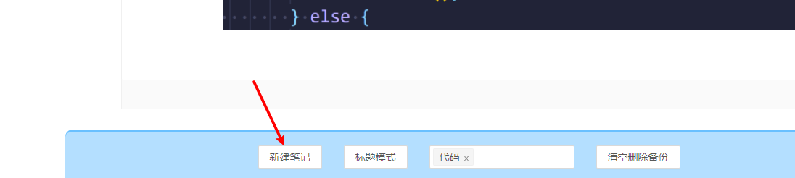
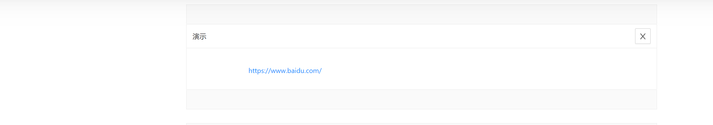
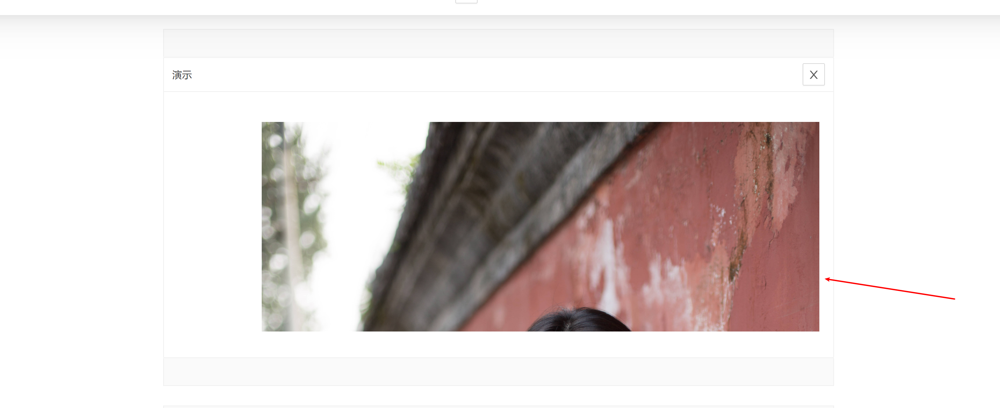
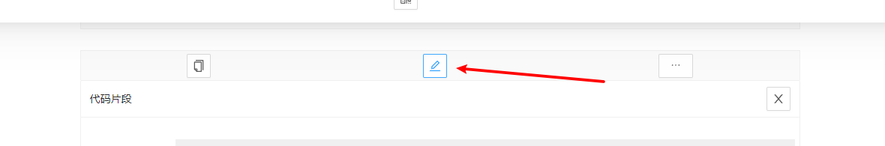
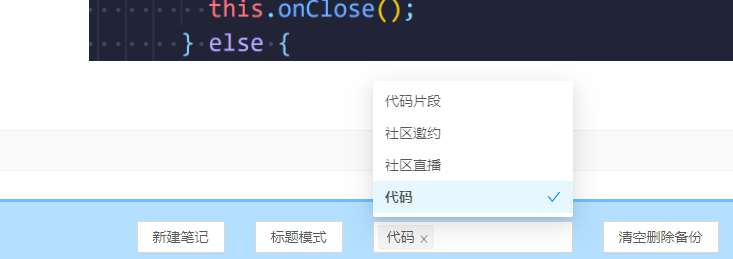
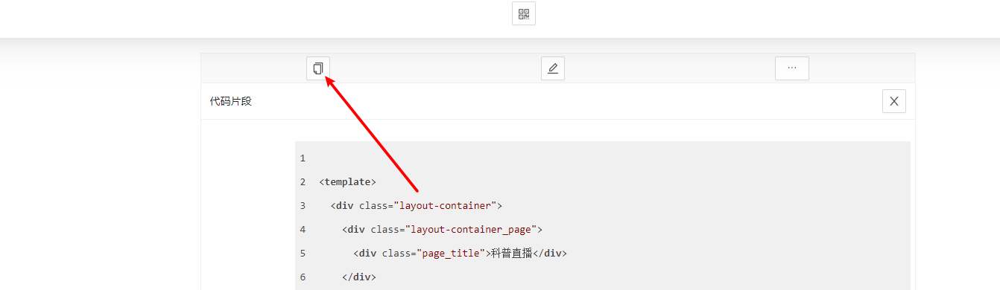
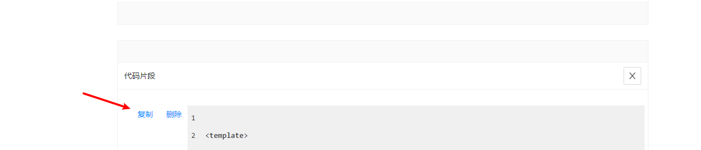
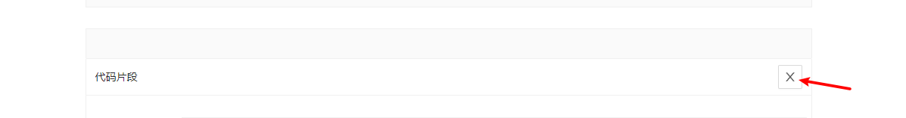
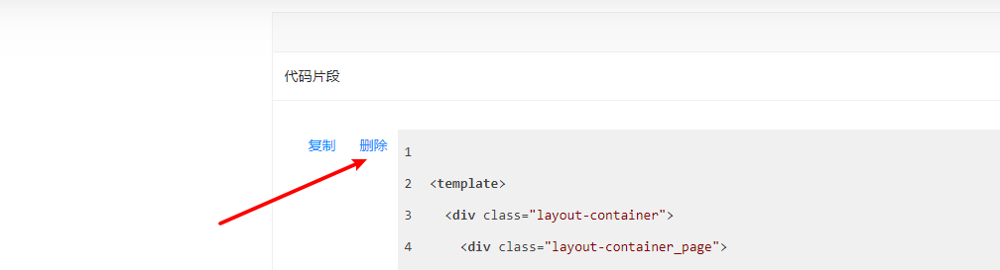
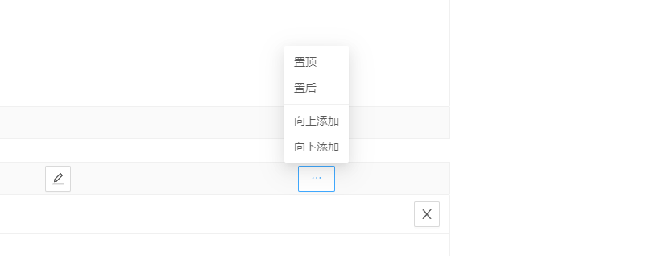

PC 端一次性加载全部记事;移动端每页 4 条,向下滚动接近列表底部时会自动加载下一页,加载中显示“加载中…”

# 实时同步

记事本页面已接入 WebSocket 实时同步。

- 新增、编辑、删除任一笔记后，其他在线客户端会自动刷新列表。

# 新建笔记

光标优先定位到内容输入框

## 标题背景色

提供默认、红色、绿色三种,后面两个是为了区分优先级,在滚动的过程中方便快速捕捉,应保持唯一或少用。

## 标题

如果不填写则默认为当前时间,但不建议这么做,要记录的事情应分门别类,这样才能提高效率。

标题提供搜索/联想功能。选择已存在的标题时,只有正文为空才会把它的内容带过来,已有内容不会被覆盖;提交时如果标题和已有记事相同,会按编辑处理合并到那条记事上,不会新增。

点击标题部分可复制

## 内容

在正文输入框中按 Ctrl+Enter 可直接保存并关闭弹窗

### 添加代码

将代码放在 \`\`\` 和 \`\`\`中间即可

### 超链接

如果是 url 则会显示为超链接,点击会在新窗口打开;链接超过 88 个字符时只显示前 60 个字符和后 25 个字符,中间用 ... 省略(复制出去的还是完整链接)

### 图片

支持黏贴截图,支持拖拽图片。

用户操作的图片会被转换成 base64 存储在磁盘上,编辑记事本时会展示为特定的格式,例如 base64img://95305.png,在其它记事中一样可以使用

如果是网络图片且后缀带有“.jpg”、“.jpeg”、“.gif”、“.png”、“.svg”、“.webp”,会直接显示图片,展示区最大高度为 300px,超出部分会被裁切

点击图片可全屏显示

# 编辑记事本

标题可更改,但不提供筛选功能

## 弹窗宽度

弹窗宽度取笔记展示区的实际宽度,和列表里的正文一样宽,窗口大小变化时会跟着重新计算。

展示区宽度由 Welcome.less 的 `width:85% / max-width:960px` 决定,弹窗不再单独写一份宽度值。

## 弹窗高度

弹窗整体高度限制在视口内(`calc(100vh - 170px)`,并且不超过 72vh),不会超出屏幕。

除标题、字号等固定行外,剩余高度全部分给正文文本框,内容超长时在**文本框内部滚动**,不让整个弹窗变高。

弹窗高度与字号无关:早期用 antd `TextArea` 的 `autoSize` 按"行数"算高度,字号调大后 8 行的高度会成倍增加,而且它以内联 `min-height` 注入,`min-height` 大于 `max-height` 时 `min-height` 生效,会把弹窗撑到屏幕外,所以改为 flex 撑满。

## 正文字号

标题下方提供正文字号滑块,可选 12~120px,默认 14px,拖动时编辑框会实时预览。

字号按单条笔记保存,编辑框和列表中的正文都按该字号显示,同一条笔记复制出去的内容也会带上该字号。

正文行高会随字号变化:小字号维持原来的行高,字号调大后按 1.6 倍撑开,避免文字重叠。

没有保存过字号的老笔记按默认值 14px 显示,不受影响。

# 关于搜索

## 标题模式

只显示标题,再次点击恢复原样

可单独展开，也可再次收起

PC 端会自动开启排序功能。

- 在每个笔记标题左侧会出现拖拽图标。
- 整个笔记区域都可以拖拽。
- 排序后顺序会自动保存。

移动端也支持标题模式开关，但不提供拖拽排序。

## 搜索内容

PC 端默认显示所有标题作为候选,也可搜正文内容,支持多选;移动端不显示搜索框

# 关于复制

复制整个记事内容

复制部分内容

# 关于删除

直接点击删除按钮,没有二次确认。点删除时会先把整条记事内容复制到剪贴板,再执行删除,误删后可以从剪贴板找回

为了防止误删,程序会先加一个`deleted:true`的标识,打开 notes.json 去掉该标识就可以在界面显示了

默认会存储 50 个,超过这个数,程序则把第一个被删除的记事从 notes.json 移除

delNote.js 的 `saveDeletedNotesCountThreshold`记录了这个值,可以进行修改

## 回收站

删除的记事不会立刻消失,而是标记 `deleted:true` 后移到 notes.json 末尾。页面底部点“回收站”可查看已删除备份(按删除时间倒序),点条目上的“恢复”会把它放回列表最前

点“清空回收站”会二次确认后永久删除,无法找回

## 删除部分内容

考虑到一个记事会有多个任务,提供了删除部分内容的能力

如果删除后正文已经为空,程序会把整条记事直接删除,不再保留空内容

# 关于位置

通过底部新建按钮添加的会出现在第一个

也可以选择"向上添加"、"向下添加"、"置顶"、"置后"

# 常见问题

## 加载列表缓慢

### 过多的图片

因为黏贴的图片是转换为 base64 存储的,比较占内存,以现在机器的处理速度,实际使用时不容易发生。

### 假删除导致

为了防止误删,程序会存储一定长度的记事本,可点击底部的“回收站”按钮,在弹窗里点“清空回收站”彻底删除(会先二次确认)

### 出现用户想要删除但实际上一直保留的内容

这一类问题是程序 bug,只能对比展示给用户的和实际存储的有哪些差异来决定,之前就曾修复用户单独删除了图片但这个图片却越积越多,从而导致加载缓慢。

# 页面导航

在 PC 端页面底部增加了“返回”按钮，点击可快速返回主页。为了保持界面简洁，该按钮在移动端会自动隐藏。

