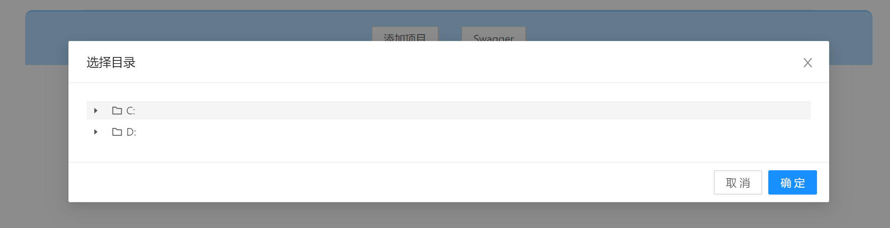
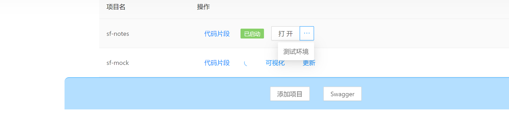

后端脚本实现依赖与平台,只在 windows 上测试过

# 添加项目




点击确定后会把本次新增项目的目录记为下次打开的起点，下次添加会自动展开到该目录

点击列表底部的"添加项目"按钮打开"选择目录"弹窗，可以勾选多个目录后一次确定，批量加入项目列表，成功后提示"已添加 N 个项目"。

已添加过的目录会显示"已添加"标签并禁止勾选，未勾选直接确定会提示"请至少选择一个目录!"；弹窗左上角的"重置"可以清掉记住的起点路径。

## 配置

点击齿轮按钮打开"配置"：可以配置多条启动命令、"终端命令"（在项目目录下执行，默认 deepcode，作用于这一行的 DeepCode 按钮）和"项目运行地址"。

配置好后会轮询运行地址判断是否启动：未启动显示"启动"，检测期间显示"启动中..."，启动成功后主按钮变成"打开"。sf-notes 自己这一行不显示"配置"按钮。


## 多环境联调

sf-mock 的 programConfig.js 有如下配置

增添如下配置

```
      apiPrefixList: ["/api"],
      serverList: [
        {
          port: 9011,
          isMock: true,
        },
        {
            port:"9012",
            name:"测试环境",
            url:"http://baidu.com.com"
        }
      ],
```

在 sf-mock 这一行点开"更新"右侧的下拉，选择"批量生成项目文件结构"，相当于进入 sf-mock 项目的 generate 目录，执行 createFileStructure.js

点同一个下拉里的"重启nginx"：先结束当前 nginx.exe 进程，再进入 generate 目录执行 writeNginxConfig.js，最后启动 nginx-1.19.6\nginx.exe

点 sf-mock 行的"更新"会重新读取 programConfig.js，刷新各项目生成的 Mock 链接；项目列表里除 sf-notes 外的项目行始终有"打开"下拉



"打开"主按钮打开的是"本地链接"，也就是项目配置的运行地址；Mock 环境（比如 9011 端口）要点右侧下拉里的"Mock 链接"，所有 /api 的请求都会被转到 mock 服务器

sf-mock 可以配置多个环境，由 nginx 按端口/域名把 /api 请求转到对应环境；不过项目列表的"打开"下拉目前只列出 Mock 环境（serverList 里 isMock 的那条）、本地链接和 IP 链接，其它非 mock 环境不会单独列出来

会自动将项目的本地连接放在项目列表里


# 快捷访问 gitlab

基于`project.json`中的`config.gitlabBasePath`字段（示例值"http://10.200.0.140"）的 GitLab 快捷入口（去主页、创建合并、处理合并）当前已在界面上隐藏，暂未开放。


# ip/域名

sf-mock 增加了新功能，为每一个项目对应的环境生成一个域名，增强区分性，例如"http://wx.mock.sf-notes:9010/home/index"、"http://wx.test.sf-notes:9010/home/index"

sf-notes 做了这个功能的接入


"ip"、"域名"的选择会影响打开链接的拼接规则

如果域名不能访问，可能是"C:\\Windows\\System32\\drivers\\etc\\hosts"没有写入权限所致，可以单独执行 writeNginxConfig.js 看看有无报错；现在检测到 hosts 没有写入权限时会自动跳过 hosts 更新并继续重启 nginx。

`project.json` 中的 `config.nginxVisitWay` 字段决定默认值，分别是 "ip"、"domain"

# 拖动排序

不同阶段每个项目的优先级是不一样的，因此新增了拖动排序功能


# 页面导航

在 PC 端页面底部增加了“返回”按钮，点击可快速返回主页。为了保持界面简洁，该按钮在移动端会自动隐藏。

# 分支与批量操作

项目行会显示当前 Git 分支，点分支按钮可以搜索并切换分支；切换时如果有未提交改动，会弹窗让你选"保留改动并切换"或"带着切换"。

点"拉取"可以更新当前项目的代码。底部"批量操作"弹窗可以全选或勾选多个项目批量"拉取"、"启动"，带进度和状态（等待/执行中/成功/冲突/失败），失败的项目可以点"日志"看输出；上次勾选的项目会被记住。

# 打开方式

列表底部的"DeepCode"按钮默认在用户文档目录执行配置的终端命令，右侧下拉可以选"Cursor"、"Terminal打开"、"在cmd打开"，同样作用在文档目录。

除 sf-notes 外的每个项目行也有一个"DeepCode"按钮：直接点击在项目目录执行终端命令，下拉可以选"Cursor"、"Terminal打开"、"在cmd打开"，以及"在文件夹打开"（打开项目所在文件夹）。

# 项目行操作

项目名前有圆形按钮可以复制项目路径，点击项目名本身会复制项目名；右侧的圆形按钮可以直接把项目从列表里移除。
